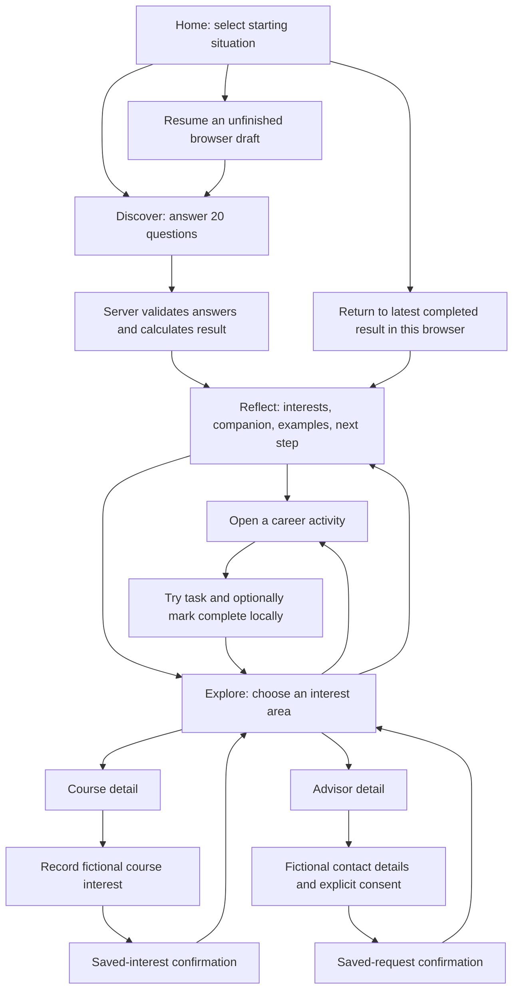

# Wayfinder: product demo pitch and presenter guide

Prepared from the current app screens, seeded quiz, and scoring implementation. This is a presentation guide, not a claim that a deployed environment has been tested. Allow roughly 6–8 minutes, including clicks. Spoken passages are in blockquotes; other text is presenter guidance.

## 1. The story to tell

**One sentence:** Wayfinder helps students explore their interests, discover career possibilities, and choose one practical next step.

**Audience:** The MVP is designed for English-speaking Myanmar students aged 18–25 exploring further study after matriculation.

**Demo story:** Follow one fictional student who enjoys creative work but does not know how that could connect to a career. Show how their interests lead to examples, an activity, and relevant learning or support options.

**Presentation order:** Problem → student journey → explanation of the quiz → practical action → current scope → next milestone and ask.

## 2. Opening — before clicking (30 seconds)

> “Imagine finishing school and being asked, ‘What are you going to do next?’ You might have several interests, or you might not know where to start. Even when you find a career that sounds interesting, the next step can still feel unclear.
>
> Wayfinder helps students explore that question through three steps: Discover, Reflect, and Explore. Let me show you how one student moves from uncertainty to a practical next step.”

## 3. Screen-by-screen demo script

### Screen 1 — Home: an approachable starting point

**Route:** `/`

**Show:** The headline, three steps, companion gallery, and “Which best describes you right now?”

**Do:** Select “I’m not sure what interests me yet,” then click **Start exploring**.

> “The first screen makes the task manageable. Students can begin whether they are unsure of their interests or have too many possibilities. There is no account to create, and the quiz has 20 questions that they can answer at their own pace.
>
> The goal is to help them find a starting point. Let’s follow a student who is still figuring things out.”

**Why this screen exists:** Explain the value, reduce the effort needed to begin, and acknowledge different starting situations. The entry choice is recorded; it does not add points to the interest scores or create a different question set.

**Transition:** “We begin by asking what kinds of activities they enjoy.”

### Screen 2 — Discover: the quiz

**Route:** `/quiz`

**Show:** One interest question, the progress indicator, Back/Next controls, and one later context question. Q15 and Q17 demonstrate choosing up to two options.

**Do:** Answer one or two representative questions live. For a short presentation, use a second tab containing a result prepared in advance in the same browser session; explicitly tell the audience you are switching to a completed example.

> “The first 12 questions ask about activities such as creating content, investigating problems, helping people, and organizing information. Students rate their interest from ‘Not interested’ to ‘Very interested.’ There are no right or wrong answers.
>
> The last eight questions ask about their situation: how they like to explore, what matters in a course, which study options are realistic, and what they are willing to try this week.
>
> These two parts serve different purposes. The first identifies interest themes. The second helps us tailor guidance and order the available learning and support options.”

**Why this screen exists:** Capture both interests and practical context. Back navigation supports revision. Drafts can be resumed in the same browser for up to seven days after the last update when browser storage is available.

**Transition:** “I’ve completed this example in advance so we can focus on what the student gets back.”

### Screen 3 — Reflect: results and companion

**Route:** `/results/[attemptId]`

**Show:** “What we found about you,” the companion, interest themes, exploration preferences, course priorities, “Your next small step,” and interest-area career examples.

**Do:** For the prepared creative-interest example, show Artistic and its career examples. Point to one score and its available points. Briefly show the companion card download; sharing appears only on supported devices.

> “Here, the student can see their interests alongside how they prefer to explore and what matters to them in a course.
>
> In this example, creative interests stand out. We show Artistic as an area to explore and offer several example careers within it. The student can compare possibilities instead of being assigned a single job.
>
> Each area shows how its interest score was calculated. We also suggest one small next step based on the student’s answers. The Myanmar-inspired companion gives them a memorable character connected to an interest theme, with a card they can download.
>
> These results are starting points for exploration. The quiz is RIASEC-inspired and has not been scientifically validated as a career assessment.”

**Why this screen exists:** Make the reasoning visible, connect broad themes to concrete examples, and give the student something useful to do next. Students can browse the other areas too.

**Companion detail if asked:** A single leading normalized interest selects its companion. Tied leading themes offer a choice among those companions. Neutral results offer all six. Choosing a companion does not change scores or resource ordering. The downloaded card is character artwork, not a personalized report of answers or scores.

**Transition:** “The next question is what it actually feels like to try this kind of work.”

### Screen 4 — Activity: explore through doing

**Route:** `/explore/[roleId]?attemptId=…`

**Show:** The activity title, estimated time, numbered instructions, reflection prompts, and completion control.

**Do:** Open **Try an activity** from a career example. Explain the task. During the demo, describe rather than claim to have completed it; show the completion state only as an illustration of the interface.

> “This page gives the student a small, self-guided activity related to the career example. A creative activity might involve making information clearer or sketching a poster, depending on the selected example.
>
> After trying it, they reflect on what they enjoyed, what felt difficult, and whether they would do something similar again. Those reflections are not collected. They can mark the step complete in this browser and keep exploring.”

**Why this screen exists:** Let students learn from an experience before making a larger commitment. Completion is stored locally and does not change the quiz scores or backend result.

**Transition:** “If that experience sparks curiosity, they can look at ways to learn more or get perspective.”

### Screen 5 — Explore: courses, advisors, and direction switching

**Route:** `/options/[attemptId]`, optionally with `?category=A` for Artistic.

**Show:** “One small step. A little more clarity,” interest-area tabs, beginner activities where available, course cards, and advisor cards.

**Do:** Return to results and select **Choose a next step**, or use an area’s courses/advisors button. Switch between two interest areas, then open a course.

> “This is where the student compares ways forward. They can switch interest areas, try another activity, look at courses, or review advisor profiles.
>
> Course ordering considers their study preferences, affordability priorities, and flexibility needs. If none of the example courses fits their chosen study format, the page says so and labels the alternatives.
>
> The current courses and advisors are fictional examples used to demonstrate the journey.”

**Why this screen exists:** Connect reflection to choices the student can inspect. Community connections are marked **Coming soon**. Sponsored content, when present, is labeled separately and does not affect interest scoring or recommendations.

**Transition:** “Let’s look at what the student sees before expressing interest in a course.”

### Screen 6 — Course detail and interest confirmation

**Route:** `/course/[courseId]?attemptId=…`

**Show:** Course summary, provider, price label, study format, demo notice, and action panel.

**Do:** Click **Record demo interest** after confirming the selected course is fictional. Show **Your interest has been recorded**.

> “The detail page helps the student inspect the course before taking action. They can review its format, provider information, and illustrative cost information.
>
> In this demo, the button records interest in a fictional course and confirms that it was saved. It does not enroll the student or take payment. This demonstrates a concrete next action after exploring a direction.”

**Why this screen exists:** Give the student enough context to express interest and make the outcome clear. The code also supports a provider link for a configured non-demo course; the fictional catalog does not demonstrate a real provider connection.

**Transition:** “Students who want a conversation can also explore the advisor path.”

### Screen 7 — Advisor detail and request confirmation

**Route:** `/advisor/[advisorId]?attemptId=…`

**Show:** Advisor specialty, fictional-profile notice, sample contact fields, consent checkbox, and confirmation.

**Do:** Use the prefilled fictional details, tick consent, and click **Submit request**. Show **Your request has been recorded**.

> “The advisor page shows the profile’s focus and a request form. The student must explicitly agree before their contact details are stored.
>
> For this demonstration, we use fictional sample details. Submitting saves the request and shows a confirmation. Message delivery and appointment booking are future work; this prototype demonstrates the request flow.”

**Why this screen exists:** Offer a human-support path with a clear consent step and a clear explanation of what submitting does.

### Closing (25 seconds)

> “That is the Wayfinder journey: discover interests, reflect on possibilities, and explore one useful next step. A student can leave with an activity to try, a course to investigate, or a clearer question to ask.
>
> Our next milestone is to test this journey with students and learn whether it helps them take action. We are looking for [student pilot participants / a school partner / verified education and advisor partners] to help us test that.”

Choose one ask that fits the audience. These are proposed next steps, not existing partnerships or commitments.

## 4. User flow

There are seven main page types. Confirmations, resume prompts, companion choices, loading, and errors are states within those pages. There is no separate login, checkout, booking, or community page in this flow.

## 5. Quiz logic: the explanation to learn

### The 30-second explanation

> “We use a transparent, rules-based system inspired by six RIASEC interest themes. The first 12 answers contribute interest points. Because the themes have different numbers of questions, we compare the points earned with the points available. We suggest the leading areas that meet our exploration threshold, retaining ties. The final eight answers tailor guidance and resource ordering without changing the interest scores.”

### Questions 1–12: interest scoring

Each answer contributes 0, 1, 2, or 3 points for increasing interest. These measure reported interest in activities, not demonstrated skill.

| Theme | What it explores | Questions | Available points | Companion |
| --- | --- | --- | ---: | --- |
| R — Realistic | Practical work, tools, materials | 1, 11 | 6 | Chinthe |
| I — Investigative | Questions, technology, evidence, analysis | 2, 7, 12 | 9 | Naga |
| A — Artistic | Design, original content, creative expression | 3, 8 | 6 | Karaweik |
| S — Social | Teaching, helping, community support | 4, 9 | 6 | Hintha |
| E — Enterprising | Leadership, persuasion, business, projects | 5, 10 | 6 | Galon |
| C — Conventional | Organizing information and checking records | 6 | 3 | Pyinsayupa |

**Calculation:** interest percentage = earned points ÷ available points × 100.

**Why normalize:** Conventional at 2/3 is 66.67%; Investigative at 5/9 is 55.56%. Comparing raw totals would favor themes with more questions. Normalization addresses unequal available points; it does not establish equal measurement reliability or scientific validity.

**Selection rule:** An area must reach at least 50% to qualify. Show the top three qualifying areas and every area tied at the third-place cutoff. Show only one or two if that is all that qualifies. If none qualify, offer all six neutrally. All six at 100% are equally qualifying; the app should not invent a single winner. Ranking uses exact ratios, with rounded percentages for display.

The 50% threshold is a product exploration rule. It is not a validated psychological cutoff or a probability of career success. Career examples illustrate the selected areas; they are not individually calculated career matches.

### Questions 13–20: context and guidance

| Question | What it asks | How the answer is used |
| --- | --- | --- |
| 13 | Current clarity about interests/careers | Adds guidance for discovering interests, comparing fields, or investigating a preferred field |
| 14 | Preferred way to explore | Helps order online/practical courses and advisors whose support types match |
| 15 | Course priorities; choose one or two | Affordability/flexibility can affect course ordering; location, family, and job concerns add guidance |
| 16 | Most appealing learning activity | Describes the preferred activity type in next-step guidance; does not change interest ranking or automatically filter activities |
| 17 | Realistic study options; choose one or two | Prioritizes matching study formats; preserves preferences even when inventory has no match |
| 18 | Readiness to choose | Changes guidance toward exploration or setting a concrete action and date |
| 19 | Desired support | Adds comparison, action-plan, new-field, or advisor guidance; relevant support types also affect advisor ordering |
| 20 | A small step the student would take this week | Selects the main suggested next action |

All 20 questions require an answer. Only Q15 and Q17 permit two selections; the others require exactly one. Both entry choices on Home lead to the same quiz.

### Resource ordering, if a judge asks for detail

Courses receive +4 for a matching study option, +2 for affordability when prioritized, +2 for flexibility when prioritized, and +1 for matching online/practical exploration preference. Ties use interest-category rank and then a stable identifier. This is preference ordering, not verified admissions or financial eligibility.

Advisors rank by the number of support types matching the student's exploration preference and desired support, then category rank and stable identifier. Sponsorship has no input into either calculation.

## 6. How the app works behind the screens

1. The browser establishes an anonymous session and starts a quiz attempt. No account is required.
2. Questions and option weights are configured in the database. The browser keeps an unfinished answer draft where storage is available.
3. On completion, the server checks that all questions and selections are valid, calculates interest scores, constructs guidance, and orders resources.
4. The app saves the completed result as a snapshot tied to the attempt. Refreshing it does not silently recalculate the original result with newer rules.
5. Results link to activities, courses, and advisors while carrying the attempt reference.
6. Course interest and consented advisor requests are saved server-side. Retry protection helps avoid duplicate writes. Activity completion and companion choice remain browser-local.

For technical questions: the implementation uses Next.js/React with TypeScript and server-side PostgreSQL/Supabase persistence. There is no LLM-based career prediction in the current scoring logic. Anonymous browser identification is not authenticated login or cross-device account sync.

## 7. Prepare one coherent example

These are staged fictional answers to produce a creative-interest example with the current seed configuration. They are not evidence from a real student.

| Questions | Example answer |
| --- | --- |
| 3 and 8 | Very interested |
| Other questions in 1–12 | A little interested |
| 13 | “I don’t know what interests me yet.” |
| 14 | “Watching demonstrations or learning online” |
| 15 | Tuition fees and affordability; length and flexibility of study |
| 16 | “Creating a design, video, or story” |
| 17 | “Online learning or short courses” |
| 18 | “I have no idea where to start.” |
| 19 | “A step-by-step action plan” |
| 20 | “Try a beginner activity in an unfamiliar field” |

Expected interest result with the current seed: Artistic 6/6 = 100%, all other areas 33.33%. Artistic alone qualifies, and Karaweik is the leading companion. The seed's affordable, flexible online Artistic course should precede its practical workshop when those records are available. Specific career names and activities depend on the installed catalog; rehearse with what your demo actually shows.

## 8. Rehearsal checklist and questions

- Complete the staged quiz before the presentation and keep its result in a second tab in the same browser session. Use the first tab to demonstrate starting and answering.
- Check that results, companion art, one activity, course details, and advisor details load in your presentation environment. Rehearse the two saved-action confirmations using fictional details.
- Do not spend the pitch reading all 20 questions. Demonstrate the two types and explain why they serve different purposes.
- In a three-minute slot, show Home → one quiz question → prepared Results → one activity, then close. Keep course/advisor branches for questions.

**“Is this scientifically validated?”**

> “No. The current quiz is RIASEC-inspired exploratory guidance. We need further evaluation before making assessment-validity claims.”

**“What is the distinctive product idea?”**

> “The design connects interest reflection to practical exploration: several career examples, a small activity, and learning or support options in one journey. The Myanmar-inspired companions add a locally relevant visual identity.”

**“Does it use AI?”**

> “The current recommendation logic is rules-based. We can explain the score and preference rules that produce the result.”

**“What happens after an advisor request?”**

> “The prototype stores it after consent. Real delivery, response handling, and booking have not been implemented.”

**“How would you measure success?”**

> “We propose measuring quiz completion, whether students understand the results, whether they try a next step, and whether their clarity improves after exploration. We do not yet have evidence of that improvement.”

**“What is the business model?”**

> “The prototype includes labeled sponsored placements. A sustainable model still needs testing with students and partners. Sponsorship is separate from scoring and recommendation ordering.”

**“What do you need next?”**

> “A small student pilot to test usability and usefulness, followed by verified course and advisor partnerships if the journey proves useful.”

Avoid claiming validated career fit, measured accuracy, real provider partnerships, confirmed enrollment, delivered advisor messages, employment forecasts, full Burmese localization, or existing pilot outcomes.

## Source map

- Page copy and behavior: `src/components/landing.tsx`, `quiz.tsx`, `results.tsx`, `interest-areas.tsx`, `options.tsx`, `explore.tsx`, and `details.tsx`.
- Scoring and resource ordering: `src/lib/scoring.ts`, `SCORING_LOGIC.md`.
- Seed questions and examples: `supabase/seed.sql`, `supabase/career_examples.sql`.
- Companion behavior: `src/lib/frontend/result-mascots.ts`, `src/components/result-mascot.tsx`.
- Scope and persistence: `README.md`, `docs/INTEREST_AREAS.md`.
